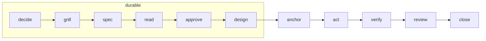

# loop 階段機設計稿

> [!IMPORTANT]
> **結論**：目前的 spec 只會記錄 spec／design 檔案的變化（例如還有幾題 open、Status 是什麼），還沒有「階段」的概念。我提議把整個流程改成一台**階段機**：
> - 每種 loop 有一串固定順序的階段。
> - 每個階段都有**進入條件**和**完成條件**，條件盡量從 book 裡的證據自動判斷，例如檔案狀態、派出的 subagent、exit code。
> - 上一個階段還沒完成就做了下一個階段的事，會**提醒一次**，不會擋。
> - 「下一步是什麼」改由程式依階段機算出來。Jev 只判斷「完成條件是不是真的達到了」，以及要往前走還是退回上一步。
>
> 你列的 Planned、Goldfished、Grilled、Designed 不全是同一類東西，下面會分開處理。最後有 4 個決定請你選。

## 這幾個名稱各是什麼

| 你列的 | 性質 | 在階段機裡的處理 |
|---|---|---|
| Planned | 狀態：決策表已經建好 | 階段 `decide`，完成條件是 `decision.md` 存在且有決策列 |
| Grilled | 過程：用拷問消掉 open 列 | 階段 `grill`，完成條件是 `decision.md` 的 open 列數為 0；一開始就沒有 open 列時自動跳過 |
| Goldfished | 事件：新的 subagent 讀過 spec | 階段 `read`，完成條件是 spec 變成 proposed 之後，有一位 fresh-reader 回報過 |
| （補）Approved | 狀態：使用者核准 | 階段 `approve`，完成條件是 `spec.md` 的 `Status: approved`，而且有 `Approved from` |
| Designed | 狀態：設計寫好 | 階段 `design`，完成條件是 `design.md` 存在，且「做法」那一節不是空的 |

所以這些都變成階段，只是完成條件的證據來源不同：有的看檔案、有的看派出的 subagent、有的看 exit code。

## 各種 loop 的階段順序



| 種類 | 階段 |
|---|---|
| `quick` | act → check → close |
| `inline` | anchor → act → verify → close |
| `reviewed` | anchor → act → verify → review → close |
| `durable` | decide → grill → spec → read → approve → design → anchor → act → verify → review → close |

## 每個階段的進入與完成條件

| 階段 | 進入條件 | 完成條件（證據） | 證據來源 |
|---|---|---|---|
| decide | 宣告 `durable` | `decision.md` 有決策列 | 自動：檔案 |
| grill | decide 完成 | open 列 = 0（一開始就是 0 則自動跳過） | 自動：檔案 |
| spec | grill 完成 | `spec.md` 的 `Status: proposed` | 自動：檔案 |
| read | spec 完成 | proposed 之後，有派出的 subagent 在 brief 裡帶了 spec 路徑，而且已經回報 | 自動：派工紀錄；偵測不到時可用 `anchorloop_stage read` 手動宣告 |
| approve | read 完成 | `Status: approved` 且有 `Approved from` | 自動：檔案 |
| design | approve 完成 | `design.md` 的「做法」一節不是空的 | 自動：檔案 |
| anchor | 前一個階段完成 | `Reality anchor:` 這一行，或 `anchorloop_stage anchor` | 自動或宣告 |
| act | anchor 完成 | 有正式程式碼的 diff | 自動：write、edit、commit |
| verify／check | act 有 diff | anchor 指令在最後一次 act 之後執行，而且 exit 0 | 自動：exit code |
| review | verify 通過 | 最後一次 act 之後有一輪審查，且 `Blocking: P0=0 P1=0` | 自動：reviewer 回報 |
| close | 這種 loop 的階段都完成或已跳過 | todo 都有去處（**唯一硬擋**） | 宣告 |

**跳過**：用 `anchorloop_stage skip <階段> <理由>`。跳過的理由會記進 book，結案摘要也看得到。

**退回**：證據變了，階段就會退回。例如核准後又把 spec 改回 proposed，`approve` 會退回未完成，這時改正式程式碼就會提醒「需要重新核准」。verify 通過後又改了程式，verify 也會退回，需要重跑。

**提醒的樣子**（一次階段跳躍只提醒一次）：

```text
anchorloop: act 開始了，但 approve 還沒完成（spec.md Status: proposed）。
跳過的話：anchorloop_stage skip approve <理由>
```

## 在 book 和 Jev 那邊看起來

`read` 摘要第一行會變成：

```text
durable · phase read ✓ → approve（缺：Status: approved）· 已跳過：grill（一開始就沒有 open 列）
```

Jev 收到的 state 會多一欄 `phase`（目前階段、下一階段、缺什麼）。下一步由程式決定，Jev 只回答兩件事：完成條件真的達到了嗎？要往前走、退回，還是問使用者？這樣 Jev 判斷錯的機會會小很多。

## 這個精神也套用到既有流程

- 現在的 anchor gate（改檔前要先有 anchor）就是 `act` 的進入條件，會併進這台階段機，不再是另外一套。
- 「審過才能 merge」是 `close` 前 `review` 的完成條件；但 merge 本身不在 loop 裡，所以仍然照現行規則走。
- straw-boss 的規劃（每個 task 一個 todo、各自有 anchor）不受影響：todo 的 `anchor` 就是那個 task 自己的 verify 條件。

```form
title: 階段機決定
submit: 送出決定
questions:
  - name: machine
    label: 1. 用階段機取代原本各自獨立的提醒（anchor gate、durable 核准提醒、兩輪阻擋提醒）？
    type: single
    required: true
    choices:
      - {value: yes, label: 用，全部併進階段機, recommended: true}
      - {value: durable-only, label: 只有 durable 用階段機，其他維持原本的提醒}
  - name: read
    label: 2. Goldfish（read 階段）怎麼判定完成？
    type: single
    required: true
    choices:
      - {value: auto, label: 自動偵測帶 spec 路徑的派工，偵測不到時手動宣告, recommended: true}
      - {value: declare, label: 一律手動宣告}
  - name: regress
    label: 3. 證據變了（例如 spec 改回 proposed、verify 之後又改程式），階段要退回嗎？
    type: single
    required: true
    choices:
      - {value: regress, label: 退回，並在下次跳躍時提醒, recommended: true}
      - {value: keep, label: 不退回，只記一筆}
  - name: next
    label: 4. 下一步由程式依階段機決定，Jev 只判斷完成條件是否真的達成、要前進還是退回？
    type: single
    required: true
    choices:
      - {value: program, label: 是, recommended: true}
      - {value: jev, label: 維持 Jev 自由建議下一步}
  - name: notes
    label: 其他意見（例如階段名稱、還想加的階段）
    type: text
```
